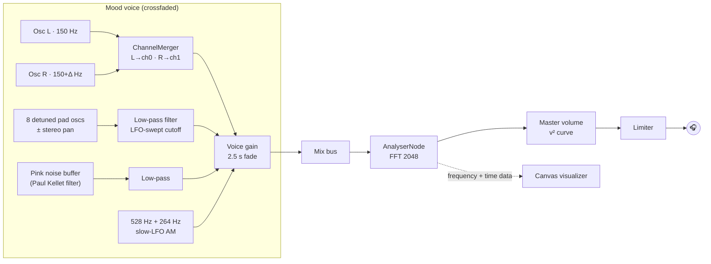

# MoodWave

**A binaural-beat mood synthesizer with a retro, neon Windows Media Player–style visualizer, built as a single HTML file with React, Tailwind CSS and the native Web Audio API.**

**Live demo:** https://moodwave-zuqu.onrender.com

Everything you hear is synthesized live in the browser. MoodWave plays no audio files. Every tone, pad, noise bed and swell is generated in real time by a Web Audio node graph, and a Canvas visualizer reads that same signal back through an `AnalyserNode` and draws it at 60 fps.

> 🎧 **Use headphones.** Binaural beats only happen when each ear receives its own tone.

---

## Features

- **Five moods, five sound worlds.** Each mood has its own binaural pair, chord voicing, filter movement and noise color, and switching moods crossfades between them over 2.5 seconds.
- **It sounds like music.** The raw test tones sit under a warm, detuned, filter-swept synth pad and a bed of filtered pink noise.
- **Each mood has its own visualizer.** The routines differ in motion, palette and geometry, from slow indigo ribbons to jagged molten spikes to morphing magenta-and-gold rose curves.
- **The visuals follow the beat.** The analyser mixes the stereo signal down to mono, which makes the binaural beat appear as an amplitude envelope, so the visuals pulse at the actual beat frequency.
- **It's built for phones too.** The canvas is DPR-aware, `ResizeObserver` resizes it smoothly, the layout adapts from mobile to desktop, and the player has touch-sized controls.
- **Polished transport.** Play and pause fade in and out without clicks, volume follows a perceptual curve, a limiter guards the output, and keyboard shortcuts cover moods and playback.
- **No build step.** The app is one `index.html`. React loads from esm.sh, and `htm` provides JSX-like templates, so no Babel is needed.

## Moods

| Mood | Left | Right | Beat | Sound | Visual |
|------|------|-------|------|-------|--------|
| 😴 Sleep | 150 Hz | 153 Hz | 3 Hz · Delta | Soft sine pad in D minor, dark pink noise | Slow indigo/violet ribbons and drifting motes |
| 🌊 Relax | 150 Hz | 156 Hz | 6 Hz · Theta | Triangle Dmaj7 pad, gentle filter tide | Mirrored teal waves woven with the live waveform |
| 🎯 Study | 150 Hz | 162 Hz | 12 Hz · Alpha | Open Dsus2 pad, brighter noise | Retro scope grid, spectrum bars, pulsing trace |
| ⚡ Amp Up | 150 Hz | 185 Hz | 35 Hz · Gamma | Sawtooth power chord with ~130 BPM tremolo | Jagged radial spikes, lightning lines, screen shake |
| 💗 Intimate | 150 Hz | 157.83 Hz | 7.83 Hz · Schumann | Fmaj7 pad plus a slowly swelling 528 Hz / 264 Hz layer | Morphing magenta-and-gold rose curves and sine rings |

## How it works

### Audio graph



- **Hard panning.** A `ChannelMergerNode` routes the left carrier only to channel 0 and the right carrier only to channel 1. Unlike a `StereoPannerNode`, this guarantees there is no bleed between ears.
- **Crossfades.** Each mood is a self-contained voice. A new voice ramps in while the old one ramps out, then stops its sources and disconnects itself in its `onended` handler.
- **Modulation.** All of it is done with audio-rate `AudioParam` connections (LFO → gain → `filter.frequency` / `gain.gain`), so there are no JavaScript timers in the audio path.
- **Analyser placement.** The analyser sits before master volume, so the visuals keep reacting at low volume.

### Visualizer

- Each frame, the visualizer computes band energies (bass, mid, high) from the FFT and an RMS level from the time-domain data.
- A decaying peak tracker normalizes that level into a `pulse` value that rises and falls with the binaural beat.
- Translucent fills create motion trails, and `globalCompositeOperation = "lighter"` gives the additive neon glow.
- The canvas is sized to `devicePixelRatio` (capped at 2) and redrawn whenever the `ResizeObserver` fires.
- The render loop reads mood and playback state from refs, so React re-renders never restart the animation.

## Tech stack

| Layer | Choice | Why |
|-------|--------|-----|
| UI | React 18 + [`htm`](https://github.com/developit/htm) via esm.sh | JSX-style components with no transpiler or bundler |
| Styling | Tailwind CSS (Play CDN) | Utility-first styling inside one file |
| Audio | Native Web Audio API | Sample-accurate synthesis and scheduling, with no libraries |
| Graphics | HTML5 Canvas 2D | Fast immediate-mode drawing with composite blending |
| Hosting | Render static site | Free, no cold starts, auto-deploys from `main` |

## Controls

| Input | Action |
|-------|--------|
| Mood buttons / `1`–`5` | Switch mood (starts playback if stopped) |
| Play button / `Space` | Play / pause with fade |
| Volume slider | Master volume |

## Run locally

```bash
git clone https://github.com/GaretJax6905/moodwave.git
cd moodwave
python3 -m http.server 8000
# open http://localhost:8000
```

Open it through a local server rather than `file://`, because browsers restrict ES module imports from local files.

## Deploy

`render.yaml` defines a Render **static site**. The build step just copies `index.html` into `site/`, so only the app is published, not the README or config. Every push to `main` redeploys automatically.

## Project structure

```
moodwave/
├── index.html    # the entire app: markup, styles, audio engine, visualizer, React UI
├── render.yaml   # Render static-site blueprint
└── README.md
```

## A note on the science

MoodWave is ambient sound design, not a medical device. Research on binaural beats affecting mood or focus is mixed. The 528 Hz "Solfeggio" and Schumann-resonance associations are cultural and folk traditions rather than established science. Keep the volume low, and don't use it while driving.

## Author

**Thomas Moylan** · [@GaretJax6905](https://github.com/GaretJax6905)

IT student at NJIT building a front-end portfolio. See also [RPS Chaos](https://github.com/GaretJax6905/rps-chaos).
